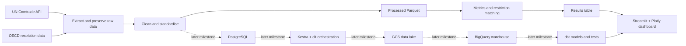

# Critical Minerals Supply Risk Platform

**An open-source data engineering and geopolitical-risk analytics project** exploring how dependent importing countries are on a small number of suppliers for critical minerals—and how much of that supply may be exposed to export restrictions.

> **Project status:** Roadmap / in development. Features, pipelines, and dashboards described below are planned milestones until they are implemented and validated in this repository.

## Overview

Critical minerals are essential inputs to technologies and industrial supply chains. A country may import most of a mineral from only a few suppliers, leaving it exposed to supply concentration or policy changes. This project aims to turn public trade and export-restriction data into a reproducible analytical platform that makes those dependencies easier to inspect.

The project starts with a deliberately small case study: **Germany's imports of natural graphite**, using HS codes `250410` and `250490` over roughly ten years. It will then expand to more minerals and importing countries as the data model and pipeline mature.

The aim is to build a useful dashboard first, then strengthen the system underneath it one layer at a time. Each milestone should leave a working, testable version rather than replacing the project with an unfinished rewrite.

## Research questions

- How concentrated are Germany's natural-graphite imports across supplier countries?
- How has supplier concentration changed over time?
- What share of imports comes from suppliers associated with relevant export restrictions?
- As the project expands, which country–commodity combinations show the greatest combination of supplier concentration and restriction exposure?

The dashboard is intended to support analysis, not to make definitive claims about future shortages or geopolitical intent. Results depend on the coverage, definitions, and quality of the source datasets.

## Initial scope

| Area | Initial approach |
|---|---|
| Importing country | Germany |
| Commodity | Natural graphite |
| Product codes | HS `250410` and `250490` |
| Time range | Approximately the latest 10 years with usable data |
| Trade data | UN Comtrade import records by partner and year |
| Policy data | OECD export-restriction data, mapped to countries and products where possible |
| Dashboard | Streamlit and Plotly |
| Initial storage | Raw source files and processed Parquet files |

Product-code definitions and the exact coverage of each source will be documented before results are interpreted. A code may cover a broader or different product category than the analytical label suggests.

## Key metrics

### Supplier share

For a given reporter, commodity, and year:

`Supplier share = import value from partner / total import value`

Shares should sum to approximately `1.0` for each complete reporter–commodity–year group, subject to rounding and the handling of missing or special trade-partner records.

### Herfindahl–Hirschman Index (HHI)

`HHI = sum of (supplier share × 100)²`

The resulting scale runs from close to `0` toward `10,000`. Higher values indicate that imports are concentrated among fewer suppliers. The dashboard may show `2,500` as a reference for high concentration, but this will be presented as an interpretive benchmark—not a universal rule for mineral-supply risk.

### Export-restriction exposure

`Exposure = import value from partners with a relevant active restriction / total import value`

The metric is only as reliable as the match between a restriction's country, product scope, and effective dates and the relevant trade records. Unmatched or uncertain restrictions must be documented rather than silently treated as confirmed exposure.

## Planned dashboard

The interface will grow as the underlying platform develops:

- **Overview:** headline KPIs, import composition by supplier, HHI over time, restriction exposure, and supplier geography.
- **Supplier dependency:** supplier rankings, concentration trends, and comparisons across countries and commodities.
- **Restrictions:** restriction coverage, exposure trends, and the evidence behind each match.
- **Global exposure:** a country-by-commodity view of concentration and exposure.
- **Pipeline health:** source freshness, run history, load counts, and test status.
- **Methodology:** metric definitions, data lineage, test results, source coverage, and limitations.
- **Alerts (demonstration):** a clearly labelled simulated event feed to demonstrate streaming concepts. Simulated events will not be presented as real policy developments.
- **Architecture:** system diagram, components, and instructions for reproducing the project.

## Architecture roadmap

The planned path evolves from a small local pipeline into a more complete data platform:



The diagram represents the **intended progression**, not a claim that every component is already operational. The initial version prioritises a simple end-to-end result; later phases add persistence, testing, containers, orchestration, cloud infrastructure, analytics engineering, and larger-scale processing.

## Technology roadmap

| Milestone | Main addition | What it demonstrates |
|---|---|---|
| `v0` | Python, `uv`, pandas, Parquet, Streamlit, Plotly | First reproducible pipeline and analytical dashboard |
| `v1` | PostgreSQL, SQL, expanded `pytest` tests | Data modelling, upserts, quality checks, and idempotency |
| `v2` | Docker and Docker Compose | Reproducible local setup for the app, pipeline, and database |
| `v3` | Config-driven countries and commodities | Reusable ingestion and comparative analysis |
| `v4` | Kestra and dlt | Scheduling, retries, backfills, incremental ingestion, and run metadata |
| `v5` | Terraform, Google Cloud Storage, BigQuery | Infrastructure as code, cloud storage, warehouse modelling, and reconciliation |
| `v6` | dbt | Staging and mart layers, documented models, lineage, and governed metrics |
| `v7` | Apache Spark / PySpark | Larger-scale processing, with results checked against existing outputs |
| `v8` | Kafka and a small Bruin comparison | Streaming concepts, validation, simulated alerts, and tool evaluation |
| `v1.0-capstone` | Integrated platform | End-to-end pipeline, tested outputs, documented methodology, and final dashboard |

Tools are added only when their learning objective is clear. Spark, Kafka, and Bruin are later-stage learning or comparison exercises; the project will document when a simpler tool is a better fit. Cloud resources are optional and will only be used after checking current quotas and potential costs.

## Results-table contract

To keep the dashboard independent from the storage and processing tools, every phase should expose the same analytical result columns:

`year, commodity, reporter, partner, import_value_usd, share, hhi, restricted_flag, exposure`

Column names should not change between phases. If the model needs to evolve, the change should be documented and tested deliberately. The pipeline should also preserve raw source responses, record source retrieval dates, and make transformations reproducible.

## Repository structure

The repository is expected to grow toward a structure similar to this:

```text
critical-minerals-platform/
├── app/                  # Streamlit dashboard
├── config/               # Commodity and reporter configuration
├── data/
│   ├── raw/              # Unmodified source extracts (not committed)
│   └── processed/        # Cleaned intermediate data (not committed)
├── docs/
│   ├── decisions.md      # Technical decisions and trade-offs
│   └── architecture/     # Architecture diagrams
├── infra/                # Terraform, introduced in a later phase
├── sql/                  # Database schema and analytical SQL
├── src/                  # Extraction, transformation, loading, and metrics
├── tests/                # Data and pipeline tests
├── .env.example          # Names of required environment variables; no secrets
├── CHANGELOG.md          # Milestone history
├── README.md
└── pyproject.toml        # Python project and dependency configuration
```

The structure is a target layout and may be introduced incrementally as the corresponding components are built.

## Getting started

The initial milestone is designed to run locally with free/open-source tools. Exact commands may change as the repository is implemented; the following is the intended workflow for Phase `v0`.

### Prerequisites

- Python version recorded in the project configuration
- [`uv`](https://docs.astral.sh/uv/) for Python project and dependency management
- A free UN Comtrade account/API key, subject to current access and quota limits
- Git

### Intended local workflow

```bash
# Clone the repository
git clone <your-repository-url>
cd critical-minerals-platform

# Install the locked project dependencies
uv sync --locked

# Create a local environment file from the example, then add your own key
# Windows PowerShell:
Copy-Item .env.example .env

# Run the pipeline and launch the dashboard once these entry points exist
uv run python run_pipeline.py
uv run streamlit run app/app.py
```

The pipeline should save untouched source responses under `data/raw/`, write cleaned data to `data/processed/`, and generate the stable results table used by the dashboard. The `.env` file must remain local and be excluded from Git. Do not commit API keys, raw data, cloud credentials, or Terraform state.

## Data quality and reproducibility

The project will add automated checks as it grows. The initial checks include:

- Supplier shares sum to approximately `1.0` for each complete group.
- HHI stays within its expected range of `0` to `10,000`.
- There are no duplicate partner/year rows at the declared grain.
- Every supplier used in a joined result can be mapped through the country crosswalk.
- Restriction matches use documented product and date rules.
- Re-running a load does not create duplicate records or unexpectedly change row counts.
- Results from later implementations are reconciled against the initial baseline within a documented tolerance.

Each milestone should update `docs/decisions.md`, add a screenshot of the dashboard, update `CHANGELOG.md`, and create a Git tag. This provides a visible record of both the analytical output and the engineering evolution.

## Limitations and interpretation

- **Trade data is not a complete picture of supply risk.** Import values do not directly measure domestic production, inventory, substitution, recycling, or the resilience of downstream supply chains.
- **Product codes have boundaries.** HS codes may aggregate different grades or uses and may change between nomenclature revisions.
- **Restriction data needs careful matching.** Restrictions can differ in product coverage, policy status, dates, exemptions, and enforcement; a country-level flag alone may overstate exposure.
- **Trade records can be revised or reported differently.** Mirror flows, re-exports, partner definitions, missing values, and revisions can affect comparisons.
- **Concentration is not the same as vulnerability.** A high HHI is a signal to investigate, not proof that a disruption will occur.
- **Synthetic streaming events are demonstrations only.** They must be clearly marked and must not be confused with observed policy events.
- **Cloud cost and free-tier availability can change.** Check current pricing, quotas, and sandbox limits before creating resources; destroy disposable infrastructure when finished.

## Learning objectives

The platform is both an analytical project and a practical learning path for data engineering. It is intended to demonstrate API ingestion, data cleaning, country standardisation, SQL modelling, idempotent loading, automated testing, containerisation, orchestration, cloud infrastructure, warehouse design, dbt transformations, distributed processing, and streaming fundamentals—all anchored to one research question and one stable dashboard.

The sequence is inspired in part by topics covered in the [DataTalks.Club Data Engineering Zoomcamp](https://github.com/DataTalksClub/data-engineering-zoomcamp). This repository is an independent project, not an official Zoomcamp project.

## Project principles

1. Build a small end-to-end version before adding infrastructure.
2. Keep the dashboard's result-table contract stable across milestones.
3. Prefer tested, reproducible analysis over extra charts or tools.
4. Keep raw data, credentials, and generated infrastructure state out of version control.
5. Document assumptions, source gaps, and failures instead of hiding them.
6. Add complexity only when it answers a learning goal or improves reliability, analysis, or reproducibility.

## Sources

- [UN Comtrade](https://comtradeplus.un.org/) — international merchandise trade statistics.
- OECD export-restriction data on industrial raw materials — the exact dataset, download date, product coverage, and any mapping assumptions will be recorded in `SOURCES.md` as ingestion is implemented.

## License

A license has not yet been selected. Add a `LICENSE` file before describing the repository as open source.
